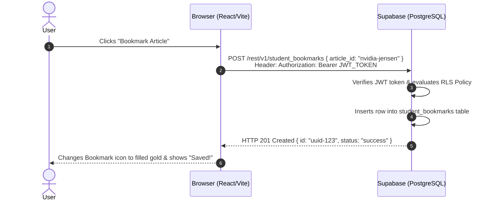

# ⚡ READSUPA.md — The Complete Supabase, Full-Stack Architecture & Developer Master Guide

> **Welcome to your ultimate engineering playbook!**  
> Whether you are building **AXIS News** or your next venture, this guide explains **what Supabase is**, **how frontend and backend systems connect**, and **everything a software developer goes through from an empty folder to a live global product**.

---

## 📑 Table of Contents
1. [What is Supabase & Why Do Developers Love It?](#1-what-is-supabase--why-do-developers-love-it)
2. [The 6 Core Functions of Supabase (With Real Code)](#2-the-6-core-functions-of-supabase-with-real-code)
3. [Frontend vs. Backend — The Mental Model](#3-frontend-vs-backend--the-mental-model)
4. [How Frontend & Backend Talk (The Complete Cycle)](#4-how-frontend--backend-talk-the-complete-cycle)
5. [The Full Start-to-End Developer Journey (From Idea to Global Launch)](#5-the-full-start-to-end-developer-journey-from-idea-to-global-launch)
6. [Your Supabase Project Configuration & MCP Integration](#6-your-supabase-project-configuration--mcp-integration)
7. [How AXIS News Leverages Supabase](#7-how-axis-news-leverages-supabase)

---

## 1. What is Supabase & Why Do Developers Love It?

### The Short Answer:
**Supabase is an open-source Backend-as-a-Service (BaaS) built directly on top of PostgreSQL.**

### The Problem It Solves:
In traditional web development, if you wanted to build an app with user accounts, a database, and file uploads, you had to manually:
1. Rent a Linux server (AWS EC2 / DigitalOcean).
2. Install and configure a database engine (PostgreSQL).
3. Write an entire backend API server (Node.js/Express, Python/FastAPI, or Go).
4. Code password hashing, salt generation, and JWT token authentication from scratch.
5. Set up WebSocket servers for live notifications.
6. Configure firewalls, SSL certificates, database connection pooling, and daily backups.

**This took weeks of grueling DevOps work before you wrote a single line of your actual app!**

### The Supabase Revolution:
Supabase gives you all of that in **one click**:
- A dedicated, high-performance **PostgreSQL relational database**.
- Built-in **User Authentication** (Google sign-in, email/password, magic links).
- Auto-generated **REST & GraphQL APIs** directly from your database tables.
- **Real-Time WebSockets** that push data changes to users in milliseconds.
- **Storage Buckets** for images, avatars, and documents.
- **Row-Level Security (RLS)** ensuring users only see data they are authorized to view.

---

## 2. The 6 Core Functions of Supabase (With Real Code)

```
┌────────────────────────────────────────────────────────────────────────┐
│                        SUPABASE PLATFORM CORE                          │
├──────────────┬──────────────┬──────────────┬──────────────┬────────────┤
│   DATABASE   │     AUTH     │   STORAGE    │   REALTIME   │ FUNCTIONS  │
│  Postgres 16 │ Google/Email │ Media/Images │  WebSockets  │ Edge Deno  │
└──────────────┴──────────────┴──────────────┴──────────────┴────────────┘
```

### 1. The PostgreSQL Database (Your Brain)
At its core, Supabase is real PostgreSQL. You can write regular SQL queries, create tables, write foreign-key relationships, and use complex data types like `JSONB` and spatial geometry.

#### Example: Creating a Table in Supabase SQL Editor
```sql
CREATE TABLE student_bookmarks (
  id UUID DEFAULT gen_random_uuid() PRIMARY KEY,
  user_id UUID REFERENCES auth.users(id) ON DELETE CASCADE,
  article_id TEXT NOT NULL,
  article_title TEXT NOT NULL,
  saved_at TIMESTAMPTZ DEFAULT now()
);
```

---

### 2. Authentication & Authorization (Your Bouncer)
Supabase handles user registration, password hashing (bcrypt), email confirmation, session tokens, and OAuth providers (Google, GitHub, Apple) securely out of the box.

#### How You Use It in React (`src/services/supabaseClient.ts`):
```ts
import { supabase } from '../services/supabaseClient';

// 1. Sign up with email & password
const { data, error } = await supabase.auth.signUp({
  email: 'student@nbu.ac.in',
  password: 'SecurePassword123!',
});

// 2. Sign in with Google (1-Click)
const { data, error } = await supabase.auth.signInWithOAuth({
  provider: 'google',
});

// 3. Get currently logged-in user
const { data: { user } } = await supabase.auth.getUser();
```

---

### 3. Row-Level Security (RLS) — The Unbreakable Shield
In typical databases, if your frontend connects to the database, anyone could theoretically query anyone else's private data.  
**Supabase solves this with Row-Level Security (RLS):** rules written directly inside PostgreSQL that check *who* is making the request before returning any rows!

#### Example RLS Rule:
```sql
-- Enable RLS on the bookmarks table
ALTER TABLE student_bookmarks ENABLE ROW LEVEL SECURITY;

-- Allow users to ONLY see their OWN bookmarks
CREATE POLICY "Users can only read own bookmarks"
ON student_bookmarks
FOR SELECT
USING (auth.uid() = user_id);
```
Even if a hacker tries to query all bookmarks from the browser console, PostgreSQL inspects their token and returns **only their own rows**!

---

### 4. Realtime Engine (The Broadcast Tower)
Instead of forcing users to refresh the page or setting up expensive polling timers, Supabase Realtime listens to PostgreSQL write-ahead logs (`wal2json`) and broadcasts changes over WebSockets instantly.

#### Real-World AXIS Example: Listening for Breaking News
```ts
import { supabase } from '../services/supabaseClient';

const channel = supabase
  .channel('breaking-news-stream')
  .on(
    'postgres_changes',
    { event: 'INSERT', schema: 'public', table: 'dispatches' },
    (payload) => {
      console.log('⚡ NEW BREAKING NEWS JUST IN:', payload.new);
      // Automatically update the React state on everyone's screen!
    }
  )
  .subscribe();
```

---

### 5. Storage (Your File Vault)
Store and serve user profile avatars, news images, PDF documents, or student resumes with built-in CDN caching and access controls.

```ts
const { data, error } = await supabase.storage
  .from('avatars')
  .upload(`profiles/${user.id}.png`, file);
```

---

### 6. Edge Functions (Your Private Cloud Workers)
Globally distributed TypeScript functions running on Deno at edge locations worldwide. Perfect for processing payments (Stripe/Razorpay), sending push notifications, or running secret automated background jobs.

---

## 3. Frontend vs. Backend — The Mental Model

To build modern software, you must understand the clear division of responsibility between **Client (Frontend)** and **Server (Backend)**:

```
┌──────────────────────────────────────┐       HTTP REST / JSON       ┌─────────────────────────────────────┐
│              FRONTEND                │ ───────────────────────────> │              BACKEND                │
│       (Runs in User's Browser)       │                              │        (Runs on Secure Cloud)       │
│                                      │ <─────────────────────────── │                                     │
│ • React / HTML / Tailwind CSS        │          WebSockets          │ • PostgreSQL Database (Supabase)    │
│ • User Clicks, Buttons, Modals       │                              │ • Authentication & Token Validation │
│ • Animations & Screen Rendering      │                              │ • Payment Processing & Secret Keys  │
│ • Local State (Active tab, filter)   │                              │ • Business Logic & Authorization    │
└──────────────────────────────────────┘                              └─────────────────────────────────────┘
```

### The Car Analogy:
- **The Frontend is the Dashboard, Steering Wheel, and Pedals**:
  - It is what the driver sees and touches.
  - When you press the accelerator pedal, the speedometer moves smoothly.
  - If the dashboard looks ugly, broken, or confusing, the driver has a terrible experience.
- **The Backend is the Engine, Fuel Injection, and Transmission**:
  - Hidden beneath the hood.
  - The driver never sees the fuel exploding inside the cylinders, but without it, the car does not move an inch!
  - It enforces safety: you cannot shift into reverse while driving 100 km/h on the highway.

---

## 4. How Frontend & Backend Talk (The Complete Cycle)

Every time a user performs an action on AXIS News, this 5-step conversation happens behind the scenes:



---

## 5. The Full Start-to-End Developer Journey (From Idea to Global Launch)

Every professional software engineer follows this exact 10-phase lifecycle when creating digital products:

```
┌───────┐   ┌───────┐   ┌───────┐   ┌───────┐   ┌───────┐
│ IDEATE│──>│ ARCH  │──>│ CODE  │──>│ SECURE│──>│ TEST  │
└───────┘   └───────┘   └───────┘   └───────┘   └───────┘
    │           │           │           │           │
┌───▼───┐   ┌───▼───┐   ┌───▼───┐   ┌───▼───┐   ┌───▼───┐
│ BUILD │──>│ DEPLOY│──>│ DOMAIN│──>│ OBSERVE│──>│ SCALE │
└───────┘   └───────┘   └───────┘   └───────┘   └───────┘
```

| Phase | What the Developer Does | Tools Used | What Can Go Wrong (And How to Fix It) |
| :--- | :--- | :--- | :--- |
| **1. Ideation & UX** | Defines the user problem, target audience, and creates wireframes | Figma, Pen & Paper | Building features nobody wants; solve a crisp, real problem first! |
| **2. Architecture** | Chooses tech stack (React vs Next vs Vite; Postgres vs Mongo) | Vite, TypeScript, React | Over-engineering early; pick modern, lightweight, fast tools. |
| **3. Frontend Code** | Builds UI components, design system, colors, modals, and responsive views | Tailwind CSS, Lucide icons | Layout shift on mobile; test every screen width from 360px to 4K. |
| **4. Database & Auth** | Designs relational schemas, foreign keys, and indexes | Supabase (PostgreSQL) | Forgetting constraints or indexing; always add foreign keys and unique IDs. |
| **5. Security Hardening** | Separates public keys from secret keys; writes RLS policies | `.env.local`, `.gitignore` | **Leaking database passwords to GitHub!** Always gitignore `.env*`. |
| **6. Testing & Quality** | Runs static typing checks and tests edge cases | `tsc --noEmit`, ESLint | Runtime crashes on null data; use TypeScript strict mode. |
| **7. Production Build** | Bundles, minifies, tree-shakes, and compresses code | Vite Rollup | Chunks too large; use dynamic imports for heavy modals. |
| **8. Deployment** | Pushes to GitHub; triggers automated CI/CD pipeline | Vercel, GitHub Actions | Environment variables missing in production; sync via Vercel CLI. |
| **9. Custom Domain** | Points DNS records (A Record, CNAME) to host; verifies SSL | GoDaddy, Namecheap | DNS propagation delay; wait 10-30 mins for global DNS caches. |
| **10. Observability** | Monitors uptime, real-time traffic, error logs, and user feedback | Vercel Analytics, Sentry | Silent failures; connect feedback forms (Formspree) and error tracking. |

---

## 6. Your Supabase Project Configuration & MCP Integration

Your project is connected to your dedicated Supabase instance:

### Project Parameters:
- **Project Reference:** `atqisdaddeiuqsyxvkeh`
- **Project URL:** `https://atqisdaddeiuqsyxvkeh.supabase.co`
- **Public Anon Key:** Configured in `.env.local` and Vercel Production
- **Database Status:** Connected and verified live.

### Model Context Protocol (MCP) Server:
The Supabase remote MCP server is configured in both:
- **Global:** `~/.gemini/config/mcp_config.json`
- **Workspace:** `.agents/mcp_config.json`

```json
{
  "mcpServers": {
    "supabase": {
      "serverUrl": "https://mcp.supabase.com/mcp?project_ref=atqisdaddeiuqsyxvkeh&features=docs%2Caccount%2Cdatabase%2Cdebugging%2Cdevelopment%2Cfunctions%2Cbranching%2Cfeedback%2Cnotebooks",
      "httpUrl": "https://mcp.supabase.com/mcp?project_ref=atqisdaddeiuqsyxvkeh&features=docs%2Caccount%2Cdatabase%2Cdebugging%2Cdevelopment%2Cfunctions%2Cbranching%2Cfeedback%2Cnotebooks"
    }
  }
}
```

### Installed Agent Skills:
Installed via `npx skills add supabase/agent-skills`:
1. **`.agents/skills/supabase`**: Official Supabase developer workflows and tool usage.
2. **`.agents/skills/supabase-postgres-best-practices`**: SQL query optimization, indexing, and schema design rules.

---

## 7. How AXIS News Leverages Supabase

| Module in AXIS News | How It Uses Supabase |
| :--- | :--- |
| [`src/components/AuthModal.tsx`](file:///Users/lavnishbansal/Desktop/Axis-news/src/components/AuthModal.tsx) | Authenticates student profiles via Google 1-Tap & verified college email |
| [`src/components/ImportantBriefingHero.tsx`](file:///Users/lavnishbansal/Desktop/Axis-news/src/components/ImportantBriefingHero.tsx) | Syncs bookmarks to student accounts across mobile and desktop |
| [`src/services/trendingService.ts`](file:///Users/lavnishbansal/Desktop/Axis-news/src/services/trendingService.ts) | Increments global atomic view counters for crowd-verified Trending Now radar |
| Live Dispatches Radar | Subscribes to real-time WebSockets to push breaking news without page reloads |

---

*Master Engineering & Architecture Document prepared for Garv Bansal · AXIS News Intelligence Platform*
